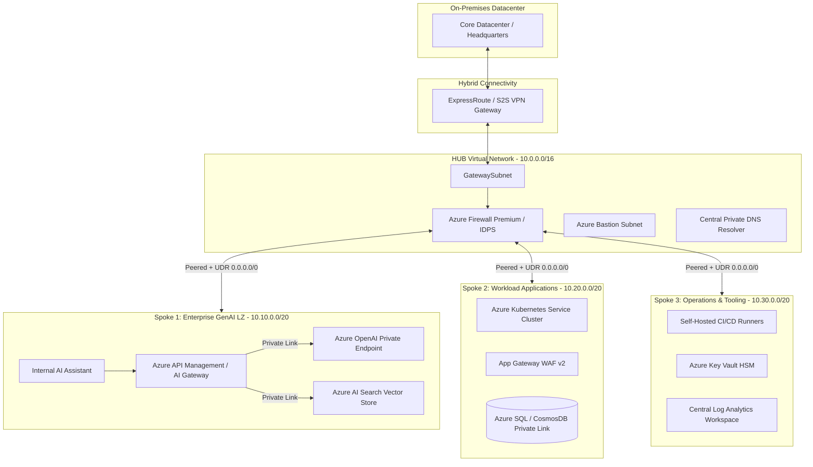

# 
👋 Hi, I'm Chandan Shahi

  

  
  
  
  
  
  

---

## 👨‍💻 About Me & Architectural Vision

I am a **Senior DevOps & Enterprise Cloud Architect** specializing in large-scale cloud transformations, zero-trust enterprise landing zones, and GenAI infrastructure enablement.

- 🔭 **Current Focus:** Architecting Enterprise-Scale **Azure Landing Zones (CAF)** with private **Azure OpenAI (LLMOps)** integration.
- 💼 **Scale & Impact:** Successfully led the end-to-end migration of **100+ enterprise workloads** with zero unexpected downtime, achieving **~28% FinOps cost reduction**.
- 🛠️ **Core Strengths:** Reusable Terraform Modules, Centralized Hub-and-Spoke Virtual Networks, DevSecOps Automation (Checkov/Tfsec/Infracost), and Enterprise Delivery Governance.
- 🎯 **Leadership:** Technical evaluation of RFPs/SOWs, vendor governance, cross-functional mentoring, and KT acceleration.

---

## 🌟 Featured Enterprise Architecture Repositories

<table>
  <tr>
    <td width="50%">
      <h3 align="center">🏛️ <a href="https://github.com/chandandevops07-gif/azure-enterprise-landing-zone">azure-enterprise-landing-zone</a></h3>
      
<b>Production-Grade Azure Landing Zone (CAF) with GenAI & Hub-Spoke</b>

      <ul>
        <li><b>GenAI Landing Zone:</b> Private Azure OpenAI & AI Search via Private Endpoints.</li>
        <li><b>Hub-and-Spoke:</b> Azure Firewall Premium inspection & forced tunneling UDRs.</li>
        <li><b>Terraform Modules:</b> Parameterized, versioned, DRY modules with remote state leasing.</li>
        <li><b>DevSecOps:</b> CI/CD pipelines with TFLint, Checkov (CIS Benchmark), and Infracost.</li>
      </ul>
      

        
      

    </td>
    <td width="50%">
      <h3 align="center">📦 <a href="https://github.com/chandandevops07-gif/Terraform-modules">Terraform-modules</a></h3>
      
<b>Reusable Enterprise Infrastructure as Code Modules</b>

      <ul>
        <li><b>VNet & Subnet Modules:</b> Standardized enterprise CIDR provisioning.</li>
        <li><b>Compute & Storage:</b> Hardened VMs, VMSS, and Storage Accounts with CMK.</li>
        <li><b>Governance:</b> Custom Azure Policy and RBAC assignment modules.</li>
        <li><b>Advanced State:</b> Nested maps, dynamic blocks, and variable validation patterns.</li>
      </ul>
      

        
      

    </td>
  </tr>
</table>

---

## 🏗️ Architectural Blueprint: Enterprise CAF + GenAI Landing Zone

---

## 🧠 Core Architectural Pillars & Enterprise Specializations

<b>1. Enterprise GenAI & LLMOps Infrastructure</b>

 

- **Zero Public Access:** Azure OpenAI, AI Search, and Cosmos DB provisioned with `public_network_access_enabled = false` and connected via **Private Endpoints (`privatelink.openai.azure.com`)**.
- **GenAI Gateway via APIM:**
  - Token-bucket rate limiting to eliminate quota exhaustion.
  - Smart multi-region load balancing across Azure OpenAI instances.
  - **Semantic Caching** using Redis to reduce latency and save **~40% token costs**.
  - Integrated Azure AI Content Safety filters against prompt injection and data leaks.

<b>2. Enterprise Hub-and-Spoke Networking</b>

 

- **Centralized Traffic Inspection:** User Defined Routes (UDRs) forcing `0.0.0.0/0` and inter-spoke traffic through Azure Firewall Premium.
- **Private DNS Architecture:** Centralized Azure Private DNS Resolver in the Hub VNet linked to all spokes and On-Premises DNS servers.
- **Micro-Segmentation:** Fine-grained Network Security Groups (NSGs) and Application Security Groups (ASGs) preventing lateral movement.

<b>3. Enterprise Governance & Management Hierarchy (CAF)</b>

 

- **Hierarchy:** Microsoft Entra ID Tenant -> Root Management Group -> Platform (Identity, Connectivity, Management) + Workloads (Corp, Online, GenAI) + Sandboxes.
- **Policy Guardrails:** Automated assignment of CIS Azure Benchmark & MCSB initiatives with enforce/deny effects.
- **Identity & Access:** Group-based RBAC with Entra ID and Privileged Identity Management (PIM) for Just-in-Time access.

<b>4. DevSecOps & Automated IaC Pipeline</b>

 

- **Shift-Left Security:** Automated PR linting (`tflint`, `terraform fmt`), security vulnerability scanning (`tfsec`, `Checkov`), and FinOps cost estimation (`Infracost`).
- **Drift Detection:** Scheduled nightly pipelines running `terraform plan -detailed-exitcode` to automatically detect out-of-band console modifications.
- **Remote State Security:** Encrypted private Azure Blob Storage with lease locking and Managed Identity authentication.

<b>5. 100+ Enterprise Workload Migration Strategy</b>

 

- **6-Phase Factory Model:** Discovery -> Assessment (Azure Migrate) -> Landing Zone Readiness -> Migration Waves -> Cutover -> Hypercare.
- **Resilience:** Pre-tested RTO (< 2 hrs) and RPO (< 15 mins) targets using Azure Site Recovery (ASR) and Geo-Replication.
- **War Room Governance:** Dedicated 24/7 hypercare support for 14-30 days post-cutover.

<b>6. FinOps (Cloud Financial Management)</b>

 

- **Waste Elimination:** Automated scripts for deleting unattached disks, orphan public IPs, and obsolete snapshots.
- **Commitment Optimization:** 1-year / 3-year Reserved Instances (RI) and Azure Savings Plans covering steady-state compute.
- **Non-Prod Scheduling:** Automated start/stop runbooks saving ~65% on non-production environments.

---

## 🛠️ Technology Stack & Tooling

<table>
  <tr>
    <td align="center" width="16.6%"><b>Cloud Platforms</b></td>
    <td>
      
      
      
    </td>
  </tr>
  <tr>
    <td align="center"><b>IaC & Automation</b></td>
    <td>
      
      
      
      
    </td>
  </tr>
  <tr>
    <td align="center"><b>Containers & Orchestration</b></td>
    <td>
      
      
      
    </td>
  </tr>
  <tr>
    <td align="center"><b>CI/CD & DevSecOps</b></td>
    <td>
      
      
      
      
    </td>
  </tr>
  <tr>
    <td align="center"><b>GenAI & Data</b></td>
    <td>
      
      
      
      
    </td>
  </tr>
  <tr>
    <td align="center"><b>Monitoring & SRE</b></td>
    <td>
      
      
      
      
    </td>
  </tr>
</table>

---

## 📊 GitHub Analytics & Activity

  
  

  

---

## 📬 Connect With Me

  
  
  

  <i>"Architecture is not just about tools; it's about business alignment, governance, and resilient engineering at scale."</i>

